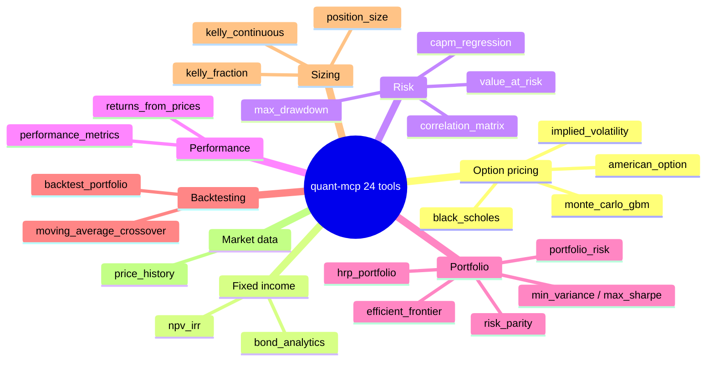
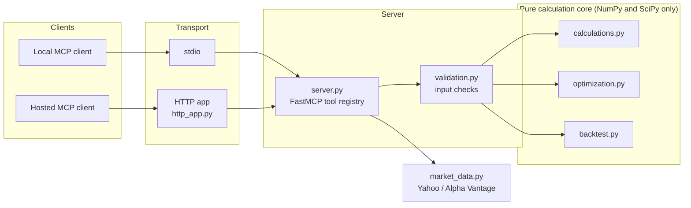
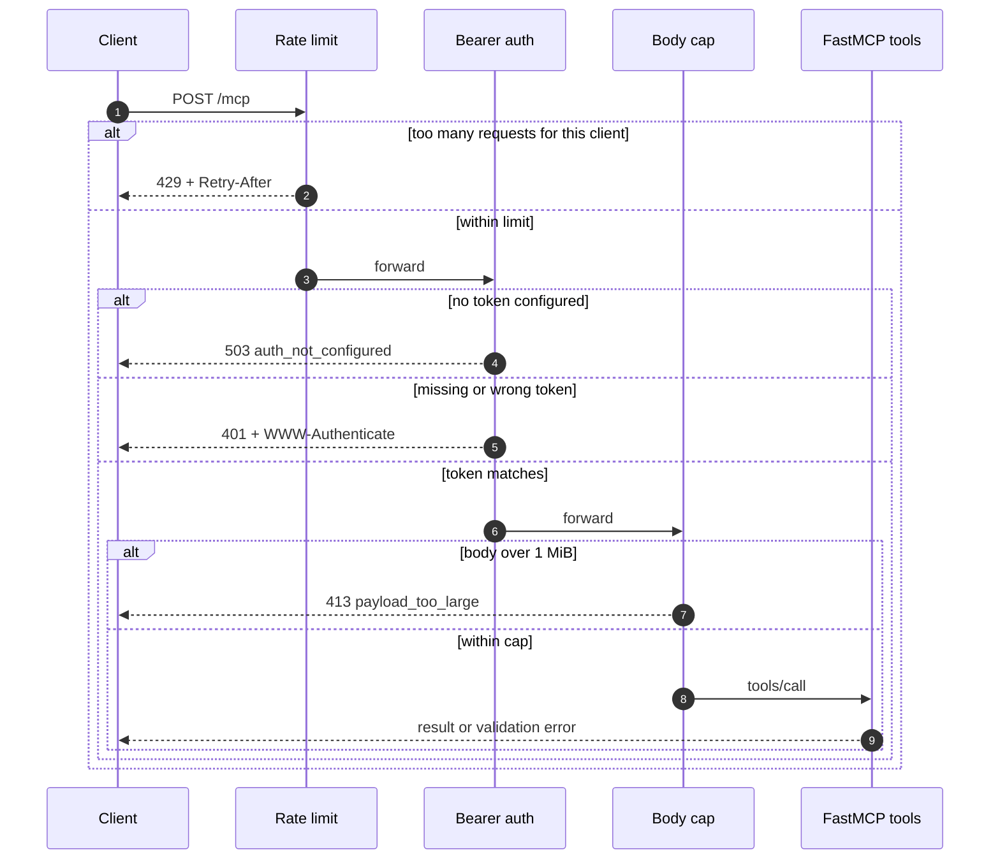
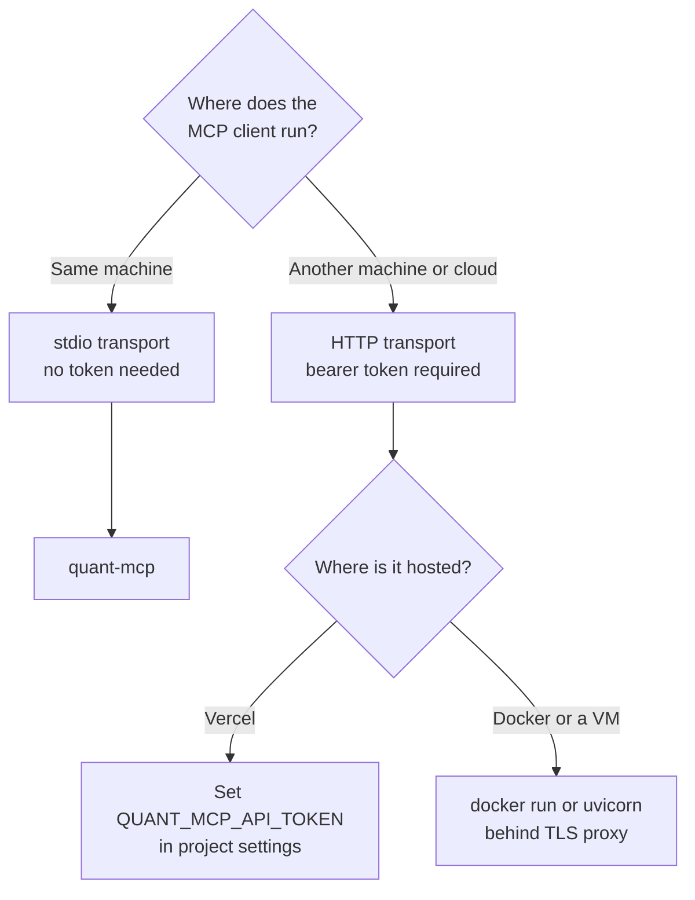

# Quant_Finance_MCP

[](https://github.com/OWNER/quant-mcp/actions/workflows/ci.yml)
[](LICENSE)
[](pyproject.toml)

A [Model Context Protocol](https://modelcontextprotocol.io) (MCP) server with quantitative finance tools: option
pricing, fixed income, risk, portfolio optimisation, backtesting and position sizing. An MCP-capable assistant can call
these tools directly on data you provide.

It runs over **stdio** for local clients, or over **streamable HTTP** for hosted deployments such as Vercel.

> **Not investment advice.** These are calculators. Outputs depend entirely on the inputs and assumptions you supply.

## Contents

- [Features](#features)
- [How it works](#how-it-works)
- [Quick start](#quick-start)
- [Running the server](#running-the-server)
- [Connecting a client](#connecting-a-client)
- [Configuration](#configuration)
- [Security](#security)
- [Conventions](#conventions)
- [Development](#development)
- [Documentation](#documentation)
- [Limits](#limits)
- [License](#license)

## Features

| Area | Tools |
| --- | --- |
| Option pricing | `black_scholes`, `american_option` (binomial tree with early exercise), `implied_volatility`, `monte_carlo_gbm` |
| Fixed income and time value | `bond_analytics` (YTM, duration, convexity, DV01), `npv_irr` |
| Risk | `value_at_risk` (historical, parametric, Cornish-Fisher), `max_drawdown`, `capm_regression`, `correlation_matrix` |
| Performance | `performance_metrics` (CAGR, Sharpe, Sortino, Calmar, skew, kurtosis), `returns_from_prices` |
| Portfolio construction | `min_variance_portfolio`, `max_sharpe_portfolio`, `risk_parity_portfolio`, `efficient_frontier`, `hrp_portfolio`, `portfolio_risk` |
| Backtesting | `backtest_portfolio` (rebalancing, transaction costs), `moving_average_crossover` (no look-ahead) |
| Position sizing | `kelly_fraction`, `kelly_continuous`, `position_size` |
| Market data | `price_history` via Yahoo Finance (no key) or Alpha Vantage (key required) |

The full parameter reference is in [docs/tools.md](docs/tools.md), generated from the live tool registry.



## How it works

The server is a thin MCP layer over pure numerical code. Tools validate their inputs, call the calculation modules, and
return results. Nothing in the calculation core does I/O.



### Request pipeline (HTTP)

Each request to `/mcp` passes through these checks in order. Each one can stop the request before the next runs.



`/healthz` and `/` skip the token check. `/healthz` also skips the rate limit.

## Quick start

Requires Python 3.11 to 3.13.

```bash
git clone https://github.com/OWNER/quant-mcp.git
cd quant-mcp
python -m venv .venv && source .venv/bin/activate
pip install -e ".[dev]"
pytest -m "not network"
```

On Windows PowerShell, activate the environment with `.venv\Scripts\Activate.ps1` instead.

## Running the server

Pick a transport based on where the client runs.



### stdio (local clients)

```bash
quant-mcp            # or: python -m quant_mcp
```

### HTTP (hosted or containerised)

```bash
export QUANT_MCP_TRANSPORT=http
export QUANT_MCP_API_TOKEN="$(python -c 'import secrets; print(secrets.token_urlsafe(48))')"
quant-mcp            # listens on QUANT_MCP_HOST:QUANT_MCP_PORT (default 127.0.0.1:8000)
```

Endpoints:

| Method and path | Auth | Purpose |
| --- | --- | --- |
| `GET /healthz` | open | Liveness probe |
| `GET /` | open | Service name, version and endpoint list |
| `POST /mcp` | `Authorization: Bearer <token>` | MCP streamable-HTTP endpoint |

Check it:

```bash
curl http://127.0.0.1:8000/healthz
curl -i -X POST http://127.0.0.1:8000/mcp -H "Content-Type: application/json" -d '{}'   # expect 401
```

### Docker

```bash
docker build -t quant-mcp .
docker run --rm -p 8000:8000 -e QUANT_MCP_API_TOKEN="$QUANT_MCP_API_TOKEN" quant-mcp
```

Deployment to Vercel, Docker hosts and self-hosting is covered in [docs/deployment.md](docs/deployment.md).

## Connecting a client

Stdio clients need only the command path. HTTP clients also need the token header.

**Local (stdio)**

```json
{
  "mcpServers": {
    "quant": {
      "command": "/absolute/path/to/quant-mcp/.venv/bin/quant-mcp"
    }
  }
}
```

**Hosted (HTTP) with Claude Code**

```bash
claude mcp add --transport http quant https://YOUR-PROJECT.vercel.app/mcp \
  --header "Authorization: Bearer $QUANT_MCP_API_TOKEN"
```

Other clients, and the generic JSON form, are in [docs/client-config.md](docs/client-config.md).

## Configuration

All configuration is through environment variables. See [.env.example](.env.example).

| Variable | Default | Purpose |
| --- | --- | --- |
| `QUANT_MCP_TRANSPORT` | `stdio` | `stdio` or `http` |
| `QUANT_MCP_API_TOKEN` | unset | Bearer token required on `/mcp`. At least 32 characters. Unset means `/mcp` returns `503`. |
| `QUANT_MCP_ALLOW_ANONYMOUS` | unset | Set to `1` to serve `/mcp` without a token. Only if the URL is protected elsewhere. |
| `QUANT_MCP_ALLOWED_HOSTS` | unset | Comma-separated Host allow-list. Setting it enables DNS-rebinding protection. |
| `QUANT_MCP_MAX_BODY_BYTES` | `1048576` | Maximum request body size |
| `QUANT_MCP_HOST` / `QUANT_MCP_PORT` | `127.0.0.1` / `8000` | HTTP bind address |
| `QUANT_MCP_LOG_LEVEL` | `WARNING` | Logs go to stderr. Tool inputs are never logged. |
| `QUANT_MCP_RATE_LIMIT_PER_MINUTE` | `60` | Per-client request limit on `/mcp`, per instance. `0` disables. |
| `QUANT_MCP_ENABLED_PROVIDERS` | `yahoo` | Market-data providers the server may call. Add `alphavantage` to enable it. |
| `ALPHAVANTAGE_API_KEY` | unset | Needed only when `alphavantage` is enabled |

## Security

- **Bearer token.** `/mcp` requires `Authorization: Bearer <QUANT_MCP_API_TOKEN>`. The comparison is constant-time. The
  server refuses to start with a token shorter than 32 characters.
- **Fails closed.** With no token set, `/mcp` returns `503` rather than running unauthenticated.
- **One shared secret.** The token grants full access to the deployment. It is not per-user, and there is no revocation
  list. Rotate it by replacing the environment variable and redeploying.
- **Rate limit and body cap.** The rate limit runs before the token check, so guessing is limited too. Request bodies are
  capped at 1 MiB.
- **Provider allow-list.** Alpha Vantage is off by default, so callers cannot spend your API quota.
- **Logs.** Tool inputs are never logged, because they can be proprietary return series.

Report vulnerabilities privately. See [SECURITY.md](SECURITY.md).

## Conventions

- Rates are annual decimals: `0.05` means 5%.
- Returns are simple periodic returns: `0.01` means 1%.
- `theta` is per calendar day, `vega` per 1 volatility point, `rho` per 1% rate move.
- Bonds assume whole coupon periods and no accrued interest.
- Backtests act on the next period (no look-ahead). Costs are charged on traded notional.

## Development

```bash
ruff check src tests app.py && ruff format --check src tests app.py
mypy
pytest -m "not network"
python scripts/generate_tool_docs.py --check
```

Live provider tests are opt-in: `QUANT_MCP_RUN_NETWORK_TESTS=1 pytest -m network`.

Smoke-test a running deployment:

```bash
QUANT_MCP_API_TOKEN=... python scripts/smoke_test.py https://YOUR-PROJECT.vercel.app
```

## Documentation

- [Tool reference](docs/tools.md)
- [Deployment guide](docs/deployment.md): Vercel, Docker, and self-hosting
- [Client configuration](docs/client-config.md): stdio and HTTP with a bearer token
- [Architecture](docs/architecture.md)
- [Changelog](CHANGELOG.md)
- [Contributing](CONTRIBUTING.md) and [security policy](SECURITY.md)

## Limits

- European options only in `black_scholes`. `american_option` uses a CRR tree with a continuous dividend yield.
- Backtests are research tools. They have no slippage model beyond a flat cost in basis points.
- Market data is not licensed or real-time. Check the terms of Yahoo Finance or Alpha Vantage before commercial use.

## License

MIT. See [LICENSE](LICENSE).
